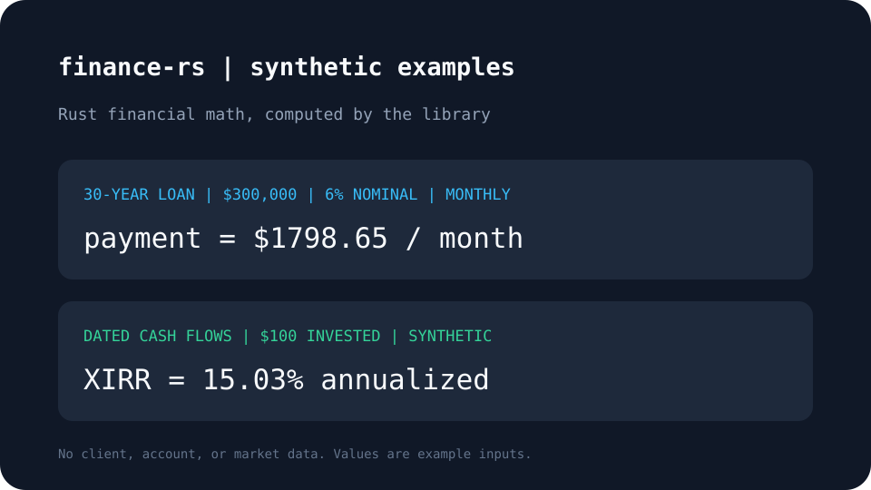

# finance-rs

finance-rs gives Rust applications a tested set of composable financial math functions, from TVM and dated returns to portfolio risk and fund waterfalls.



The rendered values use synthetic inputs. The example computes a monthly loan payment and dated XIRR with finance-rs.

## Install

Add the crate to your project:

```sh
cargo add finance-rs
```

The crate supports Rust 1.82 and newer.

## Usage

```rust
# fn main() -> Result<(), finance_rs::FinanceError> {
use finance_rs::tvm::{pmt, When};

let monthly_payment = pmt(0.06 / 12.0, 360.0, 300_000.0, 0.0, When::End)?;
assert!((monthly_payment + 1_798.65).abs() < 0.01);
# Ok(())
# }
```

The library also provides XIRR/XNPV and day counts, amortization schedules, performance and portfolio metrics, real estate and corporate valuation, venture and fund returns, fixed income, options, and actuarial calculations. Every fallible API returns `Result<_, FinanceError>`.

Reproduce the screenshot with `./docs/showcase/make-screenshots.sh`. See [the showcase notes](docs/showcase.md) and [the guide](book/src/SUMMARY.md) for more examples.

## License

GPL-3.0-or-later. This license choice follows David's decision for his published crates; confirm before publication. See [LICENSE](LICENSE).
